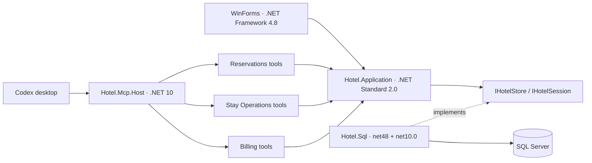

> Part of Marcel de Vries's **Opening Up Your App to AI Agents: A Practical Guide to MCP with .NET**, Visual Studio Live! Orlando 2026.
> [All demos and prerequisites](https://github.com/vriesmarcel/hotel-management-mcp-demo/blob/main/README.md) · [This checkpoint's walkthrough](DEMO.md)

# Demo 03 — separate .NET 10 MCP host and bounded contexts

This branch starts at `demo-02-no-refactor`. Demo 02 proves the legacy WinForms app can speak MCP without refactoring. Demo 03 extracts shared business operations, removes the in-process HTTP listener, and hosts MCP using `ModelContextProtocol.AspNetCore` 2.4.0 in .NET 10.



Both frontends use `Hotel.Contracts`, the same application services, and `Hotel.Sql`. WinForms does not call HTTP or depend on MCP. The host does not reference WinForms. Closing either process does not shut down the other.

| Endpoint on `http://127.0.0.1:5057` | Tools |
|---|---|
| `/mcp/reservations` | `GetAvailableRooms`, `GetPackages`, `CalculateQuote`, `CreateReservation`, `GetReservation` |
| `/mcp/stays` | `GetArrivals`, `CheckIn` |
| `/mcp/billing` | `GetBill`, `RecordPayment`, `CompleteCheckout` |

Reservations also publishes the `hotel://reservation-policy` resource and `PlanReservation` prompt. `ContextCatalogs` supplies separate catalogs through the SDK's per-request configuration in stateless mode. A tool belonging to another context cannot be listed or called through the wrong route. The three routes share a process and demo identity; they are not separate security or deployment boundaries.

## Run and debug

Requirements: Visual Studio 2026 with .NET Framework 4.8 desktop and .NET 10 support, and the existing SQL Server database.

One-time setup from this checkout:

```powershell
.\scripts\Initialize-Demo03.ps1 -SourceConfig 'C:\source\hotel-management-mcp-demo-worktrees\demo-02-no-refactor\Project_HMS\ConnectionStrings.local.config'
```

This creates a separate `Project_HMS_Demo03_<suffix>` database, copies the room/package catalog, resets occupancy, and creates the synthetic desktop account `demo-manager` / `123456`. Original bookings, guest details and logins are not copied. The original database remains unchanged. Two ignored local configuration files make normal F5 work without environment variables. Rerunning setup creates another fresh database; it never deletes an existing database.

Open `Project_HMS.sln`. Set **Multiple startup projects** to Start `Project_HMS` and `Hotel.Mcp.Host`, then F5. Stop Demo 02 first because it uses port 5057 too. For host-only debugging, make `Hotel.Mcp.Host` the startup project.

Set a breakpoint in `Hotel.Mcp.Host/ReservationTools.cs`, method `GetAvailableRooms`. Step into `Hotel.Application/ReservationsService.cs` and `Hotel.Sql/WorkflowSession.cs` to show the shared business and data layers. `Hotel.Mcp.Host/Program.cs` contains the SDK transport setup. It uses Kestrel on loopback; no HTTP.sys URL ACL or inbound firewall rule is needed for local Codex.

Alternatively, `scripts/Start-Demo.ps1` builds and starts both processes. It reports the independent host PID and stores logs in the ignored `.demo-logs` directory. Closing WinForms leaves the host running; stop the printed PID before F5. `-PrepareOnly` builds without starting processes.

Use `config/codex-mcp.example.toml` for the three client entries, with static `Authorization: Bearer 123456`. Replace the old Reservations URL rather than adding a duplicate TOML table. Reconnect/restart the client after changing MCP registrations. The five-minute tool timeout allows time at a breakpoint. Full presenter steps and prompts are in `DEMO.md`.

## Business behavior

- Dates are hotel-local calendar dates, with exclusive checkout and a maximum 365-night window.
- Quotes are saved for 15 minutes; they do not hold inventory. Pricing is `(room + food) × nights + service once`. The legacy database has no currency column, so tools do not invent a currency.
- Reservation creation checks the quote, current price and availability in one SQL transaction. It creates `Reserved` state without occupying the room.
- Check-in is allowed during the booked stay dates, changes state to `CheckedIn`, and sets the legacy room occupancy pointer.
- Payments reduce the balance. Checkout settles any remaining balance, changes state to `CheckedOut`, and clears occupancy atomically. No payment provider is contacted.
- Write tools require `confirmed=true` and a UUID `requestId`. Identical retries reuse the operation result; reusing an ID for different details fails. The confirmation flag is a demo convention, not proof of user consent or authorization.
- Room/package management and guest editing in WinForms now use typed services and parameterized SQL. All writes from either process share transaction locking. Do not run legacy writers against the migrated demo database.

Migrations are additive: `001-id-sequences.sql` supplies IDs; `002-booking-workflows.sql` stores lifecycle, quotes and operation receipts. Original tables retain their legacy types, including floating-point money columns. Decimal validation and calculations improve the boundary, but a production migration to decimal columns is still needed.

## Verify

```powershell
.\scripts\Test-Demo03.ps1 -SourceConfig 'C:\source\hotel-management-mcp-demo-worktrees\demo-02-no-refactor\Project_HMS\ConnectionStrings.local.config'
```

The runner builds both runtimes, creates a uniquely named schema copy with synthetic data, applies migrations twice, exercises application rules and actual WinForms event handlers, and runs HTTP MCP lifecycle/catalog checks on port 5059. It verifies an ownership marker before deleting only its temporary test database and compares the original database fingerprint. No existing process is stopped to free a port.

This is a localhost teaching demo. Fixed authentication, plaintext legacy desktop passwords, shared database, SQL-only payments, coarse application write locking, and a single hotel-local system clock are deliberate simplifications. Production identity, context-specific authorization, consent enforcement, auditing, payment-provider integration and MCP Apps UI are later steps.

SDK references: [official C# SDK](https://github.com/modelcontextprotocol/csharp-sdk), [ASP.NET Core transport](https://github.com/modelcontextprotocol/csharp-sdk/blob/main/docs/concepts/transports/transports.md).

To switch Codex registrations automatically (Python 3.11+): `python scripts/Configure-Codex.py --demo 3`. Use `--demo 2` to restore the original Reservations URL and disable the other two registrations. The helper backs up the config and validates that unrelated settings are unchanged. Static headers and timeouts follow the [official Codex MCP configuration](https://learn.chatgpt.com/docs/extend/mcp?surface=cli).
