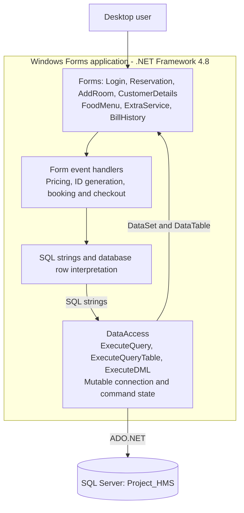
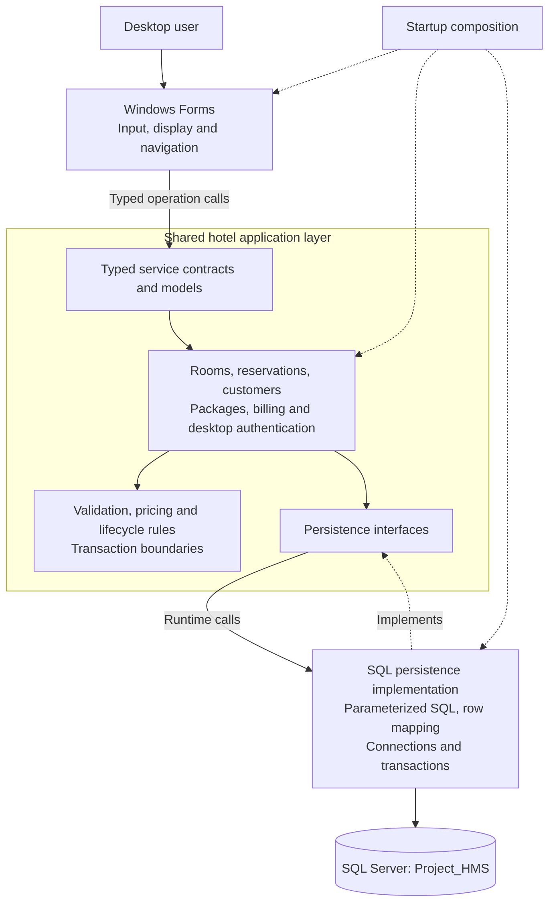
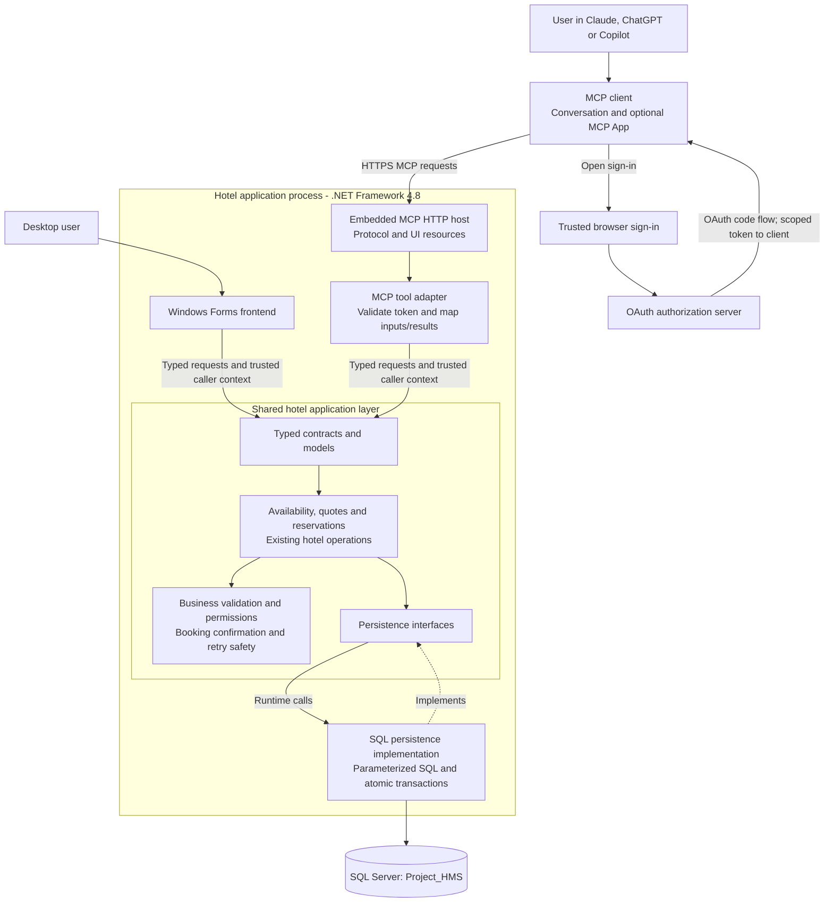

# ADR 0001: Shared hotel application layer for Windows Forms and MCP

- Status: Accepted
- Date: 2026-11-01
- Decision owner: Repository owner
- Scope: Planned architecture; no application implementation in this milestone

## Context

The existing hotel management application targets .NET Framework 4.8 and
uses Windows Forms with SQL Server. Form event handlers construct SQL,
interpret `DataSet` and `DataTable` results, calculate prices, generate IDs,
and coordinate reservation and room updates.

`DataAccess` wraps ADO.NET but accepts arbitrary SQL and exposes mutable
connection and command state. It is not a business-operation boundary.
Adding MCP tools directly on top of forms or this wrapper would duplicate
hotel rules and expose persistence details to another frontend.

The intended evolution is to let users retrieve date-range availability
and book rooms from Claude, OpenAI clients, and GitHub Copilot. Reads require
read authorization; booking requires additional user rights. Passwords must
not enter model-visible conversation, MCP tool arguments, or tool results.

The demonstration must preserve distinguishable stages: original application,
architecture decision, refactored application, and MCP-enabled application.
The original working copy and the existing `before-mcp` tag remain unchanged.

### Current coupling



## Decision

Introduce a reusable, typed hotel application layer backed by a dedicated SQL
persistence implementation. Treat Windows Forms and the future MCP server as
adapters to the same business operations.

Use in-process class libraries compatible with .NET Framework 4.8. Prefer
the simplest project structure that enforces the boundaries below. Do not
introduce an internal HTTP API, microservices, a generic CRUD framework, or an
ORM merely to achieve separation.

### Responsibilities and dependency boundaries

| Component | Owns | Must not own |
| --- | --- | --- |
| Windows Forms | Input collection, display, navigation, UI-thread marshaling | SQL, database connections, repositories, business pricing or booking rules |
| Application contracts | Typed requests, results, models, and service interfaces | Controls, MCP types, SQL types, `DataSet`, or `DataTable` |
| Application services | Validation, pricing, reservation lifecycle, business permissions, transaction boundaries | UI dialogs, protocol handling, or connection strings |
| Persistence interfaces | Focused typed reads/writes and transactional execution contracts | Arbitrary SQL exposed to frontends |
| SQL implementation | Parameterized SQL, row mapping, connection lifetime, database transaction execution | UI behavior or MCP-specific authorization flows |
| MCP adapter (future) | Protocol handling, token validation, tool/model mapping, MCP App resources | Duplicated hotel rules or direct SQL |
| Startup composition | Construct services and connect persistence implementations | Business rules |

Application services depend on persistence interfaces, not concrete SQL
classes. SQL implementations implement those interfaces. Frontends depend on
application contracts; startup code is the composition root and may reference
concrete implementations to wire them together.

Use focused services for rooms, reservations, customers, packages, billing,
and desktop authentication. Expose business operations such as
`CalculateQuote`, `CreateReservation`, and `CompleteCheckout`, rather than
public `ExecuteSql` methods. Exact signatures follow schema verification.

### Refactoring stage



Diagram arrows labeled "Runtime calls" show execution flow, not a compile-time
dependency from the application layer to the SQL implementation.

### Future state



Embedded hosting is the preferred demonstration topology, subject to verifying
SDK and HTTP transport compatibility. It runs asynchronously off the UI thread
and stops when the desktop application exits. A separate modern .NET host is
an alternative if the compatibility gate fails; the application contracts
must permit that host without duplicating business logic.

### Persistence and reservation integrity

Use parameterized SQL and operation-scoped connections. Do not share a
form-owned connection across concurrent requests. Application services define
atomic units of work; repositories participating in one operation use the same
database transaction. Do not independently commit each repository write.

Replace max-ID-plus-one allocation with a schema-appropriate, concurrency-safe
database allocation mechanism. The specific mechanism requires schema review.
Surface validation, conflict, authorization, and infrastructure failures
explicitly. Services return typed results or propagate defined exceptions;
frontends translate them to UI or protocol responses.

For future availability, model stays as hotel-local dates with inclusive
check-in and exclusive check-out. An existing reservation overlaps when:

```text
existingCheckIn < requestedCheckOut
AND existingCheckOut > requestedCheckIn
```

`Room.IsBooked` alone is not authoritative for future date-range availability.
Booking must recheck overlap in the write transaction with suitable concurrency
control. Both frontends must use this same path.

Before MCP publication, add persistent idempotency tied to the authenticated
caller and the booking payload, server-calculated pricing, and explicit
confirmation bound to the exact booking details. A duplicate request must not
create a second reservation; reuse with different details must be rejected.

### Authorization and secret handling

The MCP adapter validates OAuth tokens, including issuer, audience/resource,
expiry, and scopes. Application services enforce business entitlements using
trusted caller context. Caller roles must never be accepted as authoritative
tool arguments. Scope requests do not grant rights a user does not possess.

Plan separate `hotel.availability.read` and `hotel.booking.write` permissions.
Desktop authentication maps to trusted caller context when shared permission
checks are introduced. Do not expose desktop password authentication as an
MCP tool or silently grant every desktop caller unrestricted rights.

Use OAuth authorization code with PKCE and standards-based discovery through
an established authorization implementation. An MCP App presents sign-in
status and an entry point; actual password entry occurs on the authorization
server's browser page, not inside the chat-host-controlled iframe.

Standard delegated OAuth gives the MCP client an access token. The promise is
that passwords stay outside the conversation and MCP messages, not that the
client possesses no credentials. Never place tokens in tool results, URLs,
model context, or MCP App bridge messages. Keep database credentials outside
source control and avoid logging secrets.

Booking authorization and transaction confirmation are separate checks.
UI support, host tool approval, and model statements cannot replace either.

### Protocol and client compatibility

Target the published MCP revision `2026-07-28` for the future MCP milestone.
Verify a pinned SDK's actual protocol support before implementation. This
revision requires self-contained requests, per-request metadata and
capabilities, `server/discover`, required result discriminators, and cache
metadata for applicable responses. Modern HTTP does not use protocol sessions
or the legacy initialization handshake.

Use Multi Round-Trip Requests for supported elicitation: return
`input_required`, then handle a retry with `inputResponses`. Sensitive input
must not use form-mode elicitation. Transport retries must be safe through
application idempotency rather than SSE resumability.

Plan a separately verified `2025-11-25` compatibility path for legacy clients.
Do not claim interoperability solely from server protocol version support.
Detect MCP Apps and URL-elicitation capabilities and offer a text/browser path
without bypassing authorization or confirmation.

Verify named client surfaces and builds individually: Claude web/Desktop,
ChatGPT, an OpenAI API integration, and selected GitHub Copilot surfaces.
An API integration is responsible for its own UI and delegated credentials.
One Copilot product's UI support does not establish another's. Remote clients
need an explicitly configured reachable HTTPS endpoint; local listeners bind
to loopback by default, validate origins, and do not expose SQL Server.

## Alternatives considered

| Alternative | Assessment |
| --- | --- |
| Expose current `DataAccess` to MCP | Rejected: arbitrary SQL and no shared business-operation boundary |
| Duplicate form logic in MCP handlers | Rejected: divergent pricing, authorization, and reservation integrity |
| Move SQL into repositories but retain business rules in forms | Rejected as incomplete: MCP still cannot reuse hotel operations |
| Introduce a REST service between every frontend and SQL immediately | Deferred: unnecessary deployment and transport complexity for the first refactoring |
| Migrate all Windows Forms code to modern .NET first | Deferred: not required to establish boundaries and expands the demonstration scope |
| Separate modern .NET MCP host | Valid alternative: simpler HTTP hosting and independent lifetime, but less direct as an embedded legacy-app demonstration |

## Consequences

### Positive

- Forms and MCP share one implementation of hotel rules and reservation writes.
- Business operations can be tested without controls or a running MCP host.
- SQL and schema changes are isolated from presentation code.
- Atomic operations and explicit connection ownership support concurrent callers.
- The architecture enables a different host later without rewriting hotel rules.

### Negative and trade-offs

- Initial refactoring touches all forms that currently issue database queries.
- Typed mapping and service interfaces add code compared with direct SQL.
- The database schema and current data must be understood before migrations.
- Embedded Framework hosting needs verified transport integration and shares
  the desktop application's availability and failure boundary.
- OAuth setup and client compatibility require work beyond business-layer extraction.

## Implementation sequence and verification gates

1. Inspect the actual SQL schema, constraints, representative non-sensitive
   data, package requirements, and reservation/checkout behavior. Do not invent
   column types, guest-field defaults, or migration assumptions.
2. Extract typed contracts, application services, and SQL implementations.
   Migrate every form-owned query and update. Preserve desktop workflows,
   document necessary correctness changes, and externalize SQL configuration.
3. Verify no form contains SQL or references persistence APIs; confirm typed
   boundaries, desktop behavior, failure propagation, and transaction rollback.
4. Add date-range availability, concurrent reservation protection, trusted
   caller permissions, confirmation, and idempotency before exposing writes
   through MCP. Verify adjacent stays, overlap, concurrent conflict, and retries.
5. Implement the verified protocol/hosting path, OAuth, MCP App, and secure
   fallback UX. Test real tool calls on each selected client.

This ADR milestone implements none of those application changes. Identity
provider, exact client builds, published SDK version, HTTP adapter, and database
migrations remain implementation gates, not established capabilities.

## Decision lifecycle and demonstration tags

Use numbered Markdown ADRs under `docs/adr`, following the common
context-decision-consequences format. There is no mandatory universal ADR
standard. Keep accepted records as decision history; a materially different
decision gets a new ADR that supersedes this one.

The repository owner approved this ADR on 2026-11-01. Its status is
**Accepted**. Commit only the ADR and related documentation in this milestone,
and create an annotated `adr-before-refactoring` tag on that documentation-only
commit before application refactoring begins.

| Tag | Milestone |
| --- | --- |
| `before-mcp` | Existing sanitized original baseline; never move it |
| `adr-before-refactoring` | Accepted ADR and documentation, with baseline application source unchanged |
| `after-refactoring` | Planned verified extraction of the middle layer; do not create prematurely |
| `after-mcp` | Planned verified MCP-enabled application; do not create prematurely |

## References

- [Michael Nygard: Documenting Architecture Decisions](https://cognitect.com/blog/2011/11/15/documenting-architecture-decisions)
- [ADR guidance and examples](https://adr.github.io/)
- [MCP 2026-07-28 specification](https://modelcontextprotocol.io/specification/2026-07-28)
- [MCP revision changes](https://modelcontextprotocol.io/specification/2026-07-28/changelog)
- [MCP versioning and compatibility](https://modelcontextprotocol.io/specification/2026-07-28/basic/versioning)
- [MCP authorization](https://modelcontextprotocol.io/specification/2026-07-28/basic/authorization)
- [MCP elicitation](https://modelcontextprotocol.io/specification/2026-07-28/client/elicitation)
- [MCP Apps](https://modelcontextprotocol.io/extensions/apps/overview)
- [Official C# SDK](https://github.com/modelcontextprotocol/csharp-sdk)
